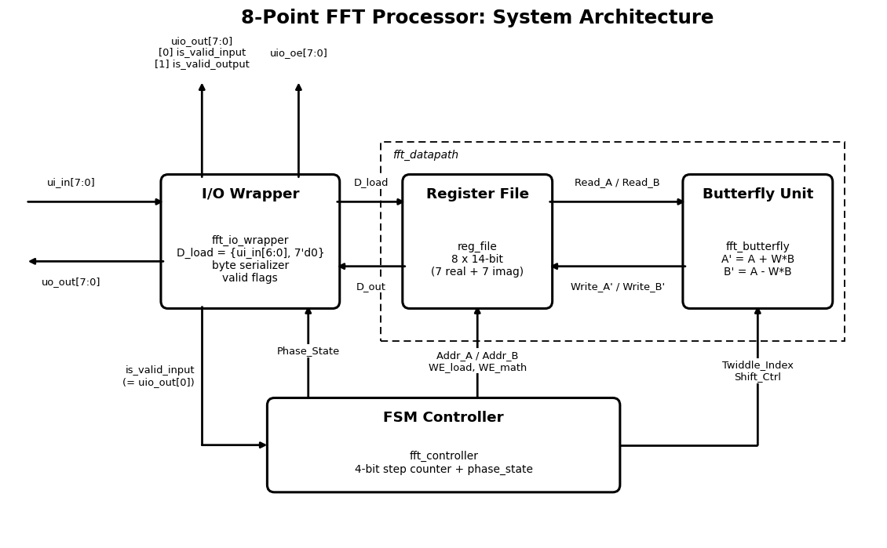

## How it works

This chip turns **8 real time-domain samples** into **8 complex frequency bins** using a radix-2 decimation-in-time (DIT) FFT:

```
X[k] = sum over n=0..7 of  x[n] * e^(-j*2*pi*k*n/8)      (k = 0..7)
```

A fully unrolled FFT needs 12 butterflies (3 stages x 4). To fit one Tiny Tapeout tile, this design is **folded**: one shared butterfly unit is reused for all 12 butterflies, one per clock, and all intermediate values stay in a small register file (in-place computation).

### Data format

| Item | Format |
|---|---|
| Input sample | 7-bit signed (two's complement), taken from `ui_in[6:0]`. `ui_in[7]` is ignored. |
| Internal word | 14 bits = 7-bit real + 7-bit imaginary (each: 1 sign bit + 6 data bits, two's complement) |
| Loaded word | `{sample[6:0], 7'd0}`, so the imaginary part starts at 0 |
| Output | 8 complex bins, each sent as 2 bytes (real, then imaginary) |
| Scaling | Each stage divides by 2 (round to nearest, saturate), so outputs are about **X[k] / 8** and cannot overflow |

### Block diagram



A vector version of this diagram is in [FFT_architecture.pdf](FFT_architecture.pdf).

### Blocks

**FSM controller (`fft_controller`)**: A 4-bit step counter plus a 2-bit phase (`Phase_State`: 0 = load, 1 = compute, 2 = output) drive everything else. It generates the register-file addresses and write enables, picks the twiddle factor, and holds `Shift_Ctrl` at 1 (divide by 2) for all stages. The write enables are decoded from the phase, so `WE_load` and `WE_math` are never high together, and `Addr_A` never equals `Addr_B` during a math write.

**Register file (`reg_file`)**: Eight 14-bit words, cleared by reset. It has two read ports, `Read_A` and `Read_B`, addressed by `Addr_A` and `Addr_B`, plus `D_out` (the word at `Addr_A`) for unloading. Writes are prioritized:
- `WE_load` writes `D_load` to `Addr_A`.
- `WE_math` writes `Write_A'` to `Addr_A` and `Write_B'` to `Addr_B`.

**Butterfly unit (`fft_butterfly`)**: A purely combinational block. It computes `W*B` for the selected twiddle, then `Write_A' = A + W*B` and `Write_B' = A - W*B`, each scaled and saturated to 7 bits per component. It also raises an `overflow` output when any of those four components had to be saturated. The twiddles are selected by `Twiddle_Index`:

| Index | Twiddle | Implementation |
|---|---|---|
| 0 | W0 = 1 | pass-through |
| 1 | W1 = (1 - j)/sqrt(2) | shift-and-add multiply by 181/256 |
| 2 | W2 = -j | swap real and imaginary, negate |
| 3 | W3 = (-1 - j)/sqrt(2) | shift-and-add multiply by 181/256, with negation |

**I/O wrapper (`fft_io_wrapper`)**: Drives the pins from `Phase_State`.
- `uio[0]` (`is_valid_input`) is high throughout the load phase and `uio[1]` (`is_valid_output`) is high throughout the output phase.
- `uio[2]` (`overflow`) is the sticky overflow flag, gated so it only shows during the output phase.
- It forms `D_load` from `ui_in[6:0]`.
- During output it uses its own counter to send the real byte `{0, real[6:0]}` on even cycles and the imaginary byte `{1, imag[6:0]}` on odd cycles. `uo_out` is 0 outside the output phase.

The top module `tt_um_daniel6872_fft` ties these blocks together. The FSM takes its `is_valid_input` from `uio_out[0]`, so it loads a sample on every load cycle.

The top module also holds a **sticky overflow latch** (`overflow_latched`). It is cleared by reset and by every `WE_load`, and set when a `WE_math` write coincides with the butterfly's `overflow`. The latch drives the wrapper's `overflow_flag` input, so it covers every butterfly of the current frame.

### Operating sequence (36 cycles per frame)

| Cycles | Phase | `uio[0]` | `uio[1]` | What happens |
|---|---|---|---|---|
| 1-8 | Load | 1 | 0 | One sample per clock is written to the register file in bit-reversed order: x[0..7] go to addresses 0, 4, 2, 6, 1, 5, 3, 7 |
| 9-20 | Compute | 0 | 0 | One butterfly per clock, 3 stages x 4 butterflies. Each result is written back in the same clock edge. |
| 21-36 | Output | 0 | 1 | (`uio[2]` = overflow) 16 bytes: X[0] real, X[0] imag, X[1] real, ... X[7] imag |

After cycle 36 the FSM returns to the load phase. The next frame starts on the very next clock edge, with no idle gap.

Butterfly schedule as `(Addr_A, Addr_B, twiddle)`:

| Stage | Butterfly 0 | Butterfly 1 | Butterfly 2 | Butterfly 3 |
|---|---|---|---|---|
| 0 | (0,1,W0) | (2,3,W0) | (4,5,W0) | (6,7,W0) |
| 1 | (0,2,W0) | (1,3,W2) | (4,6,W0) | (5,7,W2) |
| 2 | (0,4,W0) | (1,5,W1) | (2,6,W2) | (3,7,W3) |

Bin X[k] ends up at register address k, so the output phase reads the addresses in natural order.

### Pin table

| Pin | Dir | Name | Description |
|---|---|---|---|
| `clk` | in | clk | Clock |
| `rst_n` | in | rst_n | Active-low reset. It clears the register file and returns the FSM to the start of the load phase. |
| `ui_in[6:0]` | in | `sample_in[6:0]` | Signed 7-bit real input sample |
| `ui_in[7]` | in | unused | Ignored |
| `uo_out[6:0]` | out | `result_out[6:0]` | Signed 7-bit real or imaginary value of the current output byte |
| `uo_out[7]` | out | `result_imag_flag` | 0 = real byte, 1 = imaginary byte |
| `uio[0]` | out | `load_valid` (`is_valid_input`) | High while the chip is accepting samples |
| `uio[1]` | out | `output_valid` (`is_valid_output`) | High while `uo_out` carries result bytes |
| `uio[2]` | out | `overflow` | High only during the 16 output cycles, and only if any butterfly saturated in this frame |
| `uio[7:3]` | in | unused | Not driven by the design (`uio_oe` = `0x07`) |

### Team split and timeline

| Task | Due | Owner |
|---|---|---|
| Register file | Oct 15 | Chris |
| FSM controller | Oct 15 | Daniel |
| Butterfly unit | Nov 1 | Chris |
| I/O top-level wrapper | Nov 1 | Daniel |
| Integration | Nov 15 | Both |
| Python cocotb testing | Nov 30 | Both |

## How to test

### Simulation

From `test/`, run `make -B` for the RTL simulation (add `GATES=yes` for the gate-level netlist after hardening). The cocotb tests in `test/test.py` do the following:
- Compare the `uo_out` and `uio_out` pins after every clock edge against a cycle-accurate Python model of the FFT.
- Check the FSM control signals against the expected butterfly schedule (RTL only).
- Check the fixed-point model against an ideal DFT/8, within 2 LSB.
- Run hand-checked frames (DC, impulse, Nyquist, all-zero), edge cases and random frames, back to back.
- Check the 36-cycle frame timing and `uio_out` pattern over several frames.
- Apply reset at every position in a frame and check that the next frame is correct.
- Test the register file, butterfly, datapath, I/O wrapper and FSM controller individually (RTL only).

### On the chip

1. Reset the chip: hold `rst_n` low for a few clocks, then release it. `uio[0]` goes high, which means the chip is accepting samples.
2. On each of the next 8 rising clock edges, set `ui_in[6:0]` to the next sample, x[0] first. There is no handshake, so a sample must be present on every one of those edges.
3. `uio[0]` falls. Wait 12 clocks while both flags are low and `uo_out` is 0.
4. `uio[1]` goes high. Read `uo_out` on each of the next 16 clocks. Bytes alternate real (`uo_out[7]` = 0) and imaginary (`uo_out[7]` = 1), starting with X[0]. Sign-extend `uo_out[6:0]` from bit 6.
   `uio[2]` (`overflow`) is high during these 16 clocks only if some butterfly result saturated in this frame, which means the outputs may be clipped.
5. `uio[0]` goes high again immediately and the next frame begins.

Worked examples (inputs in decimal, bytes in hex):

| Input x[0..7] | Expected result | Output bytes |
|---|---|---|
| `32, 32, 32, 32, 32, 32, 32, 32` | X[0] = 32, every other bin = 0 | `20 80` then `00 80` seven times |
| `32, 0, 0, 0, 0, 0, 0, 0` | every bin = 4 + 0j | `04 80` eight times |

## Limitations

- Precision is 6 data bits plus sign per component, and each stage rounds. Outputs are within about 2 LSB of the ideal DFT/8.
- Results are scaled by 1/8, so small input signals lose resolution at the output.
- Input and output are streamed with no handshake. The chip cannot be paused mid-frame, and a reset aborts the frame in progress.
- Total time per frame is 36 clock cycles. The wall-clock time depends on the clock you apply, for example 3.6 us at the 10 MHz set in `info.yaml`.

## External hardware

None required. A logic analyzer or microcontroller is the easiest way to drive `ui_in` once per clock and capture `uo_out`, `uio[0]` and `uio[1]`. With the Tiny Tapeout demo board you can also use the input switches (`ui_in`) and watch `uo_out` and the valid flags on the LEDs, but this needs a slow, manually stepped clock.
